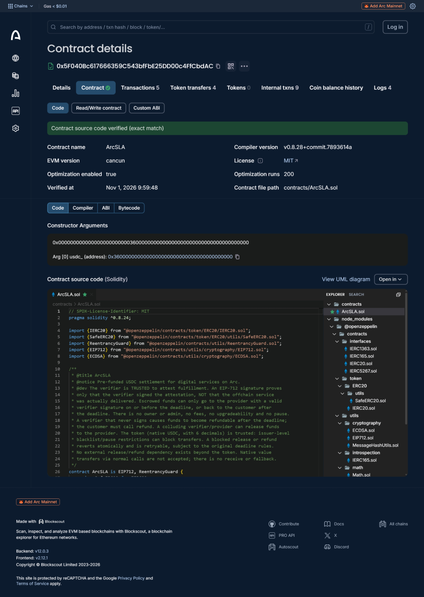

# ArcSLA: Verifiable Service Settlement

ArcSLA is a programmable USDC settlement protocol for digital services on Arc. A customer pre-funds an agreement, a named verifier signs an EIP-712 fulfillment attestation, and the escrowed USDC is released to the provider in a single transaction. If the deadline passes without a release, the customer claims a full refund.

Built with [Arc Studio](https://studio.arc.io)

## Judge Quick Start

For ARC Microgrants Round 2 reviewers, see the
**[ArcSLA Judge Guide](docs/JUDGE_GUIDE.md)** for the
Arc Studio project, live application, verified Arc Mainnet
transactions, Guided Demo instructions, and security limitations.

## What it does

- **Create and fund** an agreement: provider, trusted verifier, USDC amount, deadline and a hash of the service specification. The exact amount moves into escrow in the same transaction.
- **Verify and release**: the verifier signs a typed attestation with their wallet. Anyone can submit it; the contract checks the signer, expiry, specification, provider and deadline, then pays the provider.
- **Expire and refund**: after the deadline, the customer claims the whole escrow back.
- **Public explorer**: browse agreements, settlements and transactions with no wallet.
- **Guided demo**: a nine step walkthrough whose onchain progress is read from live contract state, events and receipts; the read-only invalid-signature test is recorded per browser.

No owner, no admin withdrawals, no fees, no upgradeability. The verifier is trusted to attest fulfillment: a valid signature proves the verifier approved the work, not that the offchain service was delivered. See `docs/SECURITY.md`.

## Tech stack

- Solidity 0.8.28, OpenZeppelin 5.6.1 (SafeERC20, ReentrancyGuard, EIP712, ECDSA), Foundry
- React 18, Vite, TypeScript, Tailwind CSS
- wagmi v2, viem v2, ConnectKit
- Arc Testnet and Arc Mainnet with native USDC (6 decimals as an ERC-20)

## Repository layout

```
contracts/ArcSLA.sol             Smart contract
contracts/test/                  Foundry tests
contracts/script/DeployArcSLA.s.sol   Foundry deploy script
contracts/abi/ArcSLA.abi.json    Exported ABI
src/                             Frontend (pages, components, hooks)
docs/                            Security model, deployment, mainnet evidence checklist
```

## Development

Prerequisites: [Bun](https://bun.sh) and [Foundry](https://book.getfoundry.sh).

```bash
bun install
cp .env.example .env     # optional: nothing is required, see below
bun run dev              # http://localhost:5173
```

Contracts:

```bash
forge build              # or: bun run contracts:build
forge test               # or: bun run contracts:test
bun run abi:export       # regenerate the ABI after a contract change
bun run check            # lint + typecheck for the frontend
```

### Tests

`forge test` ran 202 tests passing (203 total; one optional fork test is skipped unless `ARC_FORK_RPC` is set, and it currently needs Arc Foundry) at the time of writing. They cover creation and funding, every creation rejection, verifier release, deadline refund, wrong signer, wrong specification hash, wrong provider, wrong agreement ID, expired attestation, release after deadline, premature refund, double release, double refund, release after refund, refund after release, replay across contracts and chain IDs, reentrancy through hostile tokens, USDC transfer failure, signature tampering and encodings, deadline boundaries, role checks, fuzzing, and multi-actor balance invariants. See `docs/SECURITY_REVIEW.md` for the review results and remaining risks. The invariant suite makes the full run take a couple of minutes. Real USDC issuer blacklist behavior cannot be tested locally and should be checked on testnet.

### Environment variables

| Variable | Purpose |
| --- | --- |
| `VITE_DEFAULT_NETWORK` | Network the site opens on: `testnet` (default) or `mainnet`. Visitors can switch with the Testnet / Mainnet selector. |
| `VITE_ARC_CHAIN_ID` | Older setting, still honoured when `VITE_DEFAULT_NETWORK` is unset (5042 selects mainnet). |
| `VITE_ARCSLA_ADDRESS`, `VITE_ARCSLA_DEPLOY_BLOCK` | No longer needed. Contract addresses and deployment blocks live in `src/lib/networks.ts`, one entry per network. A `VITE_ARCSLA_ADDRESS` that differs from the registered deployment disables every transaction. |
| `VITE_USDC_ADDRESS` | Optional override of the USDC token address. |
| `USDC_ADDRESS`, `RPC_URL`, `ARCSLA_MAINNET_CONFIRM` | Only for the Foundry deploy script. The script accepts only Arc Testnet or Arc Mainnet and only Arc's official USDC address. |

Vite reads `.env` only at startup, so restart the dev server after changing it.

## Testnet evidence

Two lifecycle transactions on Arc Testnet (contract `0x2C4283d953C8D5141F47eA8AB74d9FB2A7831B47`) were supplied by the project owner and re-checked against the chain RPC on 2026-10-30:

- Release: [`0xc3f34d15…98f194c3`](https://explorer.testnet.arc.io/tx/0xc3f34d15b779d2c570e8f8f513593bd25eb6f1487534007eb4a5a08b98f194c3) (agreement #1, 1 USDC paid to the provider)
- Refund: [`0x84315c80…2f53e9e`](https://explorer.testnet.arc.io/tx/0x84315c8040879c04147375471694d395db007b70afeadf798fe1a9f3b2f53e9e) (agreement #2, 1 USDC returned to the customer after the deadline)

These are testnet results only. See `docs/SECURITY_REVIEW.md` for details and remaining risks, and `docs/TESTNET_ADVERSARIAL_EVIDENCE.md` for read-only adversarial checks run against the deployed contract (`bun run scripts/testnet-adversarial.ts`).

## Networks

Arc Testnet and Arc Mainnet are separate configurations selected when the page loads: `?network=` in the URL, the header selector (saved in the browser), then `VITE_DEFAULT_NETWORK`, then testnet. Everything (contract, chain, RPC, explorer links, event scan, wallet checks) follows the selected network. See `docs/NETWORK_CONFIGURATION.md`.

Offline tests: `bun run test` (network configuration, Create-form deadline/amount rules and Guided Demo step 9 and progress across wallet switches; nothing is sent or signed). `bun run scripts/check-demo-journey-live.ts` replays the demo progress read-only against the deployed contracts. `bun run test:rejection-live` runs the step-9 rejection test read-only against the deployed contracts on both networks.

## Live testnet runbook

The app includes a step-by-step page at `/demo/live` for running a verified release and a deadline refund on Arc Testnet with your own wallets. It never signs or sends anything by itself. After you finish, `bun run scripts/record-live-evidence.ts` reads the receipts and logs from the chain and writes them to `docs/TESTNET_ADVERSARIAL_EVIDENCE.md`.

## Arc Mainnet — Verified & Published Source Code (1 November 2026)



*Arc Mainnet Explorer (Blockscout): Contract source code verified — exact match.*


**Verification status: Verified — Exact Match (Blockscout).**

The deployed ArcSLA smart contract source code has been publicly verified and published on Arc Mainnet Explorer.

- **Contract:** `0x5F040Bc617666359C543bfFbE25DD00c4FfCbdAC`
- **Verified source:** [Arc Mainnet Explorer](https://explorer.arc.io/address/0x5F040Bc617666359C543bfFbE25DD00c4FfCbdAC?tab=contract)
- **Compiler:** Solidity `v0.8.28+commit.7893614a`
- **EVM version:** `cancun`
- **Optimizer:** enabled, 200 runs
- **License:** MIT
- **Constructor argument:** Arc Mainnet USDC (`0x3600000000000000000000000000000000000000`)
- **Verification method:** Solidity Standard JSON Input
- **Result:** Contract source code verified (**exact match**)

This confirms that the published source code reproduces the deployed contract bytecode under the verified compiler configuration. Source verification is not an independent security audit.

## Verified Arc Mainnet deployment and evidence (31 October 2026)

ArcSLA is deployed on **Arc Mainnet (chain ID 5042)** at [`0x5F040Bc617666359C543bfFbE25DD00c4FfCbdAC`](https://explorer.arc.io/address/0x5F040Bc617666359C543bfFbE25DD00c4FfCbdAC), deployment block `28741163`. Official Arc Mainnet USDC: `0x3600000000000000000000000000000000000000`.

- **Agreement #1: released.** 0.01 USDC paid to the provider; [release transaction](https://explorer.arc.io/tx/0x5aee3380c1c68652e7eca03a7b16bda20617976f90d6d99aa0bed46232f5ad5d), block `28754752`.
- **Agreement #2: refunded.** 0.01 USDC returned to the customer after expiry; [refund transaction](https://explorer.arc.io/tx/0x6abb3325713d120d1ad1a3949be3ba8df9a26c75b03a957735d2ef5f1245afb6), block `28756901`.
- **Signature rejection:** the Guided Demo performs a read-only simulation with a tampered signature, which returns `InvalidSigner` when evaluated with an Active-state override. This is **not** an onchain rejection transaction; step 9 is recorded in each visitor's browser.

**Public app:** https://arc-studio-03513f4fbb9b478ebcce4c02.vercel.app/  
**Arc Studio project:** https://studio.arc.io/app/03513f4f-bb9b-478e-bcce-4c02cb31d36a

The verifier is trusted; a valid signature does not independently prove service delivery. The contracts have not had an independent professional audit. Mainnet UI limits (0.01 USDC per agreement, at most 2 hours) are frontend restrictions, **not** enforced by the contract. No additional mainnet transactions are needed to inspect the demo.

## Historical planning documents

Some files in `docs/` (including `MAINNET_DEPLOYMENT_RECORD.md`, `MAINNET_READINESS_AUDIT.md`, and deployment runbooks) are **historical snapshots written before the successful mainnet settlement and refund**. Statements in those files that no agreement or deployment exists are obsolete. The current deployment and transaction links above take precedence. These historical documents are retained to show the development process, not as current status reports.

## Deployment and development

See `docs/DEPLOYMENT.md` for historical deployment procedures. The current app supports both Arc Testnet and Arc Mainnet; the default public site opens on Testnet for safety. Select Mainnet in the header or use `?network=mainnet` to inspect the verified journey. No deployment or wallet action is required to view existing evidence.
