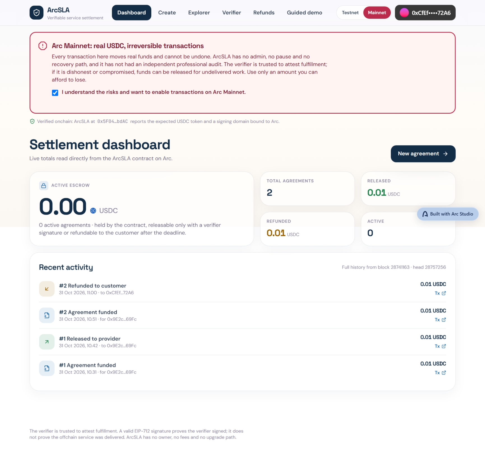
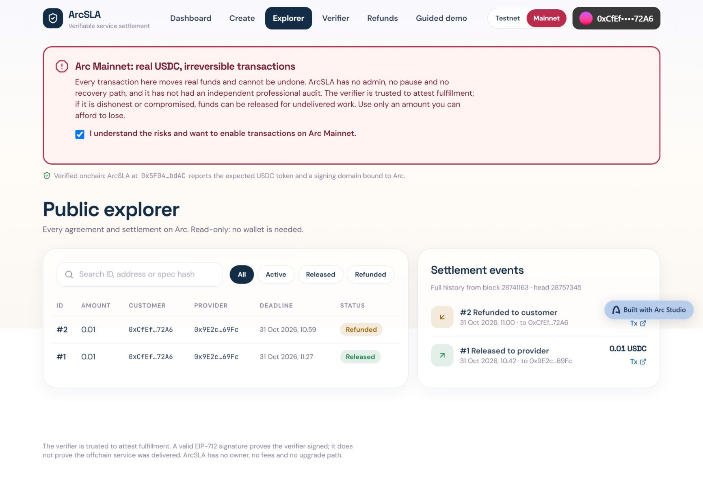
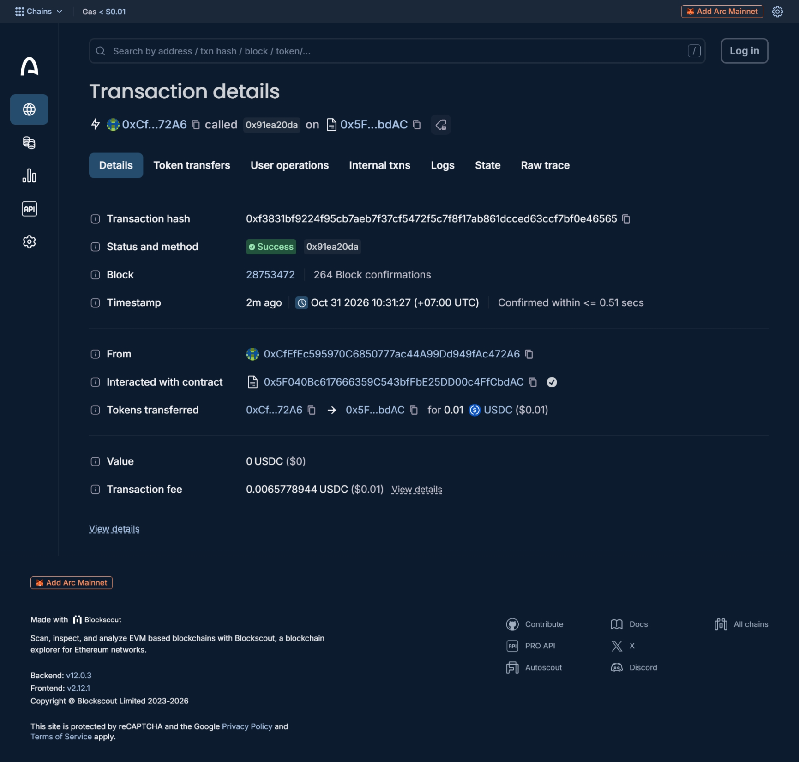
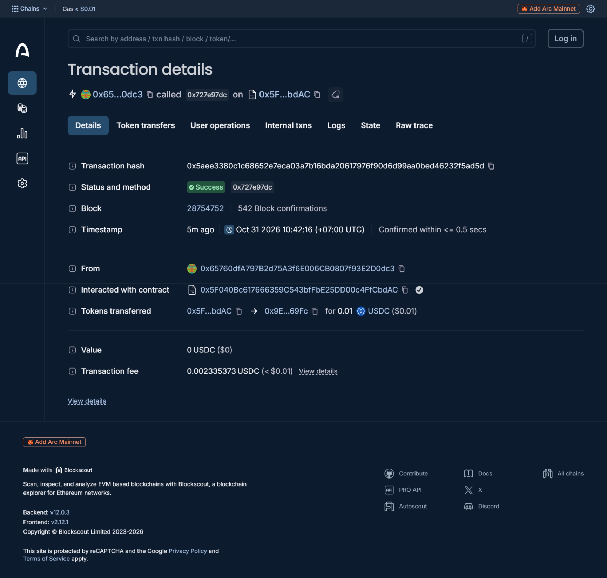
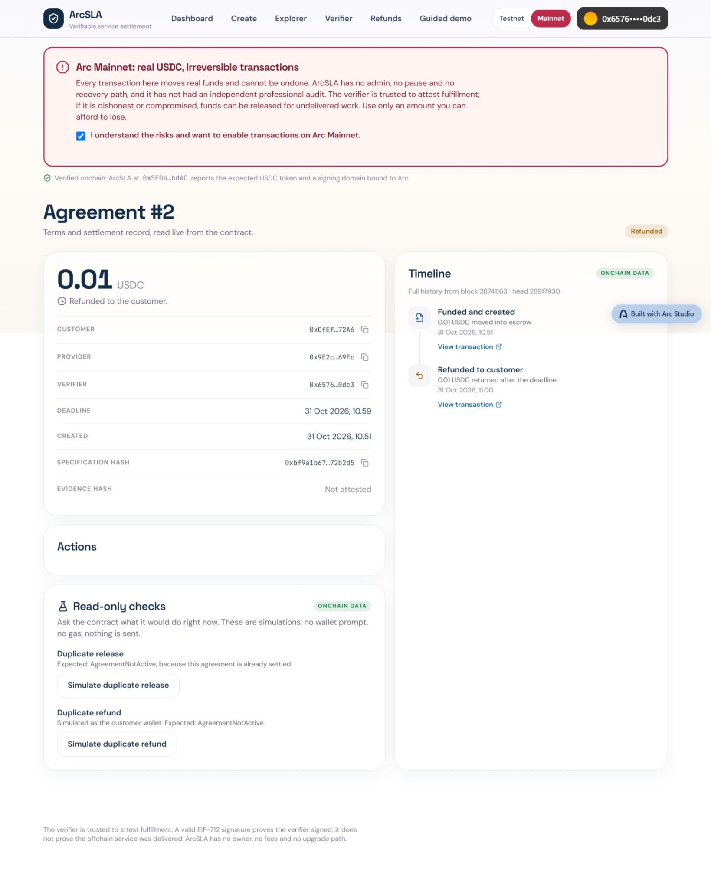
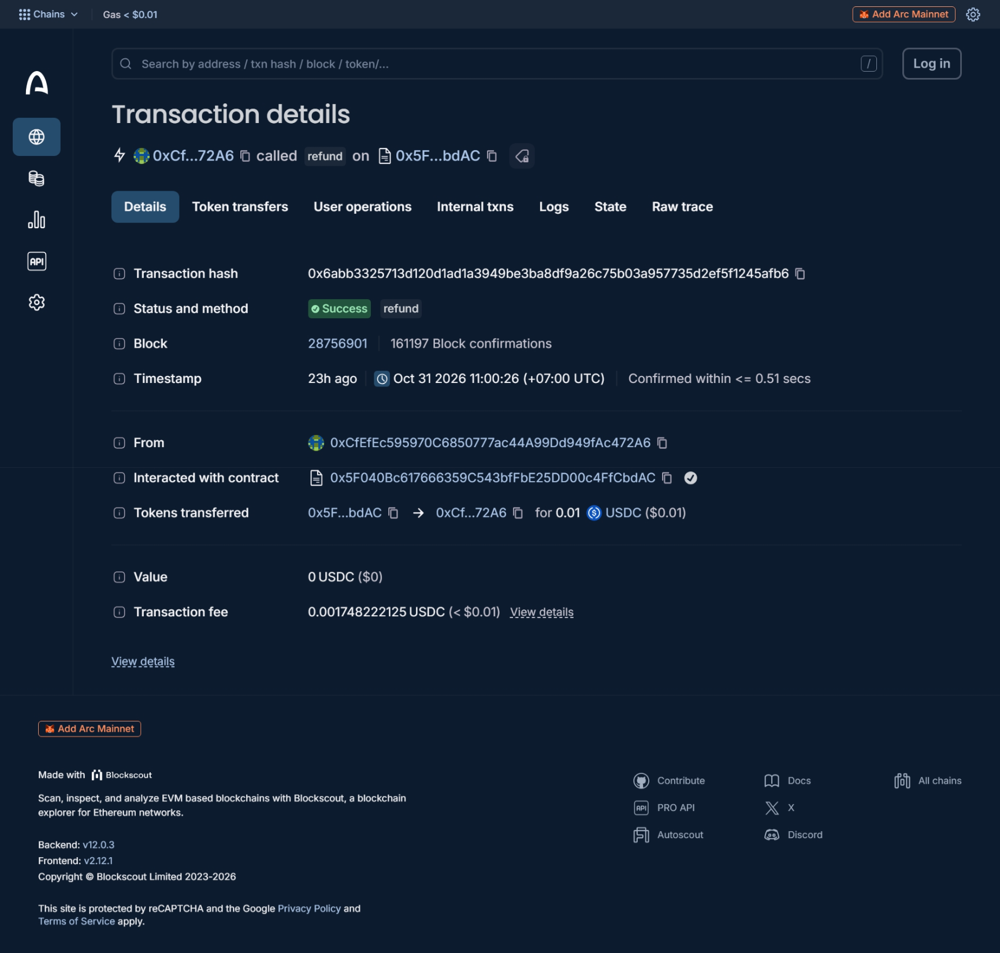
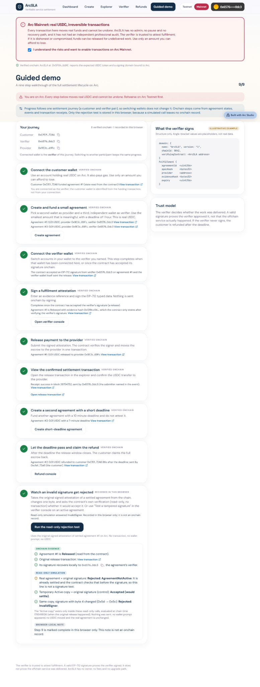

# ArcSLA — Judge Guide

**Verifiable Service Settlement Protocol on Arc**

Built with Arc Studio | Arc Mainnet | USDC Escrow | EIP-712 Attestations

## 1. Project Overview

ArcSLA is a programmable USDC escrow protocol for digital services built with Arc Studio.

Traditional service payments require customers to trust providers before delivery or require intermediaries to manually release funds. ArcSLA introduces an onchain settlement workflow where a customer funds an agreement, a designated verifier authorizes fulfillment through an EIP-712 signature, and the smart contract releases payment to the provider.

If settlement does not occur before the agreement deadline, the customer can claim a refund.

The protocol provides verifiable payment execution and transparent settlement evidence. It does not independently verify the quality or delivery of offchain services.

## 2. Quick Links

| Resource | Link |
|---|---|
| Arc Studio project | https://studio.arc.io/app/03513f4f-bb9b-478e-bcce-4c02cb31d36a |
| Live application | https://arc-studio-03513f4fbb9b478ebcce4c02.vercel.app/ |
| Mainnet Guided Demo | https://arc-studio-03513f4fbb9b478ebcce4c02.vercel.app/demo?network=mainnet |
| Source repository | https://github.com/zzzyyyddd/arcsla |
| Arc Mainnet contract | https://explorer.arc.io/address/0x5F040Bc617666359C543bfFbE25DD00c4FfCbdAC |

## 3. Built with Arc Studio

Arc Studio was the primary development environment used to build and iterate on ArcSLA.

The project includes:

- Solidity escrow smart contract and Foundry test suite.
- React, Vite, and TypeScript frontend.
- Arc Mainnet and Arc Testnet configuration.
- Wallet connectivity and network-aware transaction safeguards.
- Public agreement explorer and transaction evidence.
- Guided Demo with settlement journey verification.
- Read-only signature rejection testing.

The Arc Studio project is available through the link above for organizer review.

The source code was exported from Arc Studio and published to GitHub. The public application is deployed on Vercel.

## 4. Verified Arc Mainnet Evidence

**Network:** Arc Mainnet  
**Chain ID:** 5042  
**Contract:** `0x5F040Bc617666359C543bfFbE25DD00c4FfCbdAC`  
**Deployment block:** `28741163`  
**Official USDC:** `0x3600000000000000000000000000000000000000`

### Agreement #1 — Successful Settlement

- Customer funded a 0.01 USDC escrow agreement.
- The designated verifier authorized fulfillment using an EIP-712 signature.
- The contract released 0.01 USDC to the provider.
- Transaction succeeded at block `28754752`.

Transaction:

https://explorer.arc.io/tx/0x5aee3380c1c68652e7eca03a7b16bda20617976f90d6d99aa0bed46232f5ad5d

### Agreement #2 — Deadline Refund

- Customer funded a separate 0.01 USDC agreement.
- The agreement expired without settlement.
- The customer successfully claimed the refund.
- Transaction succeeded at block `28756901`.

Transaction:

https://explorer.arc.io/tx/0x6abb3325713d120d1ad1a3949be3ba8df9a26c75b03a957735d2ef5f1245afb6

Together, these transactions demonstrate both successful payment settlement and the deadline-based refund path using real Arc Mainnet USDC.

## 5. Guided Demo — How to Verify

Open:

https://arc-studio-03513f4fbb9b478ebcce4c02.vercel.app/demo?network=mainnet

The Guided Demo presents one customer-verifier-provider settlement journey.

Steps 1–8 derive their completion from live contract state, events, and transaction receipts. Progress is associated with the settlement journey rather than the currently connected wallet.

Step 9 is a separate read-only negative-signature test.

### Signature Rejection Test

Select **Run the read-only rejection test** in the Guided Demo.

The test evaluates:

1. The original signature against the already-settled agreement, which returns `AgreementNotActive`.
2. The original signature under a simulated Active-state override, where it is accepted.
3. A modified signature under the same simulation, which is rejected with `InvalidSigner`.

The Active-state override is used for read-only testing. It does not modify the deployed contract or blockchain state.

**Important:** Step 9 is not an onchain rejection transaction. Its completion is recorded locally in the visitor's browser. The test requires the original signature to be available; otherwise the application reports that the test is unavailable.

The demo can be inspected without creating new agreements or spending USDC.

## 6. Security Model and Limitations

ArcSLA uses a designated verifier model. The verifier is trusted to attest that the service has been fulfilled.

The contract checks the signed attestation and enforces settlement conditions, but a valid verifier signature does not independently prove that an offchain service was delivered correctly.

Additional properties and limitations:

- No owner-controlled withdrawal mechanism.
- No upgradeable contract administration.
- No protocol settlement fee.
- EIP-712 typed attestations with signer and agreement validation.
- Deadline-based customer refunds.
- Reentrancy and token-transfer handling covered by contract tests.
- No independent professional smart contract audit has been completed.
- Mainnet application limits of 0.01 USDC per agreement and a maximum two-hour deadline are frontend safeguards, not contract-enforced limits.

See `docs/SECURITY.md` and `docs/SECURITY_REVIEW.md` for additional details.

## 7. Source Code and Reproducibility

The public repository contains:

- `contracts/ArcSLA.sol` — escrow contract.
- `contracts/test/` — Foundry contract tests.
- `src/` — application frontend.
- `scripts/` — network, demo, and evidence verification utilities.
- `docs/` — deployment records, security documentation, and evidence.

Development prerequisites: Bun and Foundry.

```bash
bun install
bun run check
bun run test
forge test
```

Some network-dependent tests require the appropriate RPC connectivity and configuration.

The README records the contract test results at the time of testing; those results should not be interpreted as an independent security audit.

## 8. What Judges Should Evaluate

ArcSLA demonstrates:

- A working Arc Studio-built application.
- A deployed escrow protocol on Arc Mainnet.
- Real USDC settlement and refund transactions.
- Verifiable transaction evidence through Arc Explorer.
- EIP-712 authorization with read-only negative testing.
- A public, inspectable frontend and source repository.
- Explicit documentation of trust assumptions and security limitations.

**The central achievement is not merely displaying blockchain transactions, but connecting a complete service-payment lifecycle to verifiable onchain settlement and refund evidence.**

## Arc Mainnet — Visual Evidence

The screenshots below document real Arc Mainnet transactions on 31 October 2026. Screenshots are historical captures; verify the latest state using the live app and explorer links.

### 1. Settlement dashboard



### 2. Public agreement explorer



### 3. Agreement #1 — escrow funded



### 4. Agreement #1 — provider paid



[Verify release on Arc Explorer](https://explorer.arc.io/tx/0x5aee3380c1c68652e7eca03a7b16bda20617976f90d6d99aa0bed46232f5ad5d)

### 5. Agreement #2 — refunded to customer





[Verify refund on Arc Explorer](https://explorer.arc.io/tx/0x6abb3325713d120d1ad1a3949be3ba8df9a26c75b03a957735d2ef5f1245afb6)

### 6. Guided Demo — 9/9



**Evidence distinction:** Steps 1–8 are reconstructed from onchain state, events and receipts. Step 9 is a browser-local result from a read-only `eth_call` simulation, **not** an onchain rejection transaction. The simulation shows the modified signature rejected with `InvalidSigner`; no gas or funds were spent.
